# EverAfter — 婚禮管理系統

> 一人 full-stack 開發並上線的婚禮 SaaS。從籌備、宴客當天到婚後謝卡，一套系統管完。

**線上站**：<https://everafter-iota.vercel.app><br>
**想動手玩**：clone 後 `npm run dev` 零設定啟動完整系統（見[本機啟動](#本機啟動)）

<!-- 產品短片：影片檔不進 repo，放在 GitHub 附件（issue #204 的留言）。網址要獨立一行，GitHub 才會顯示成播放器 -->
https://github.com/user-attachments/assets/bf47cdb9-686b-4d4d-a0f8-cb053ae0339b

50 秒看完一場婚禮的三個階段：籌備 → 當天 → 婚後。

<sub>畫面全部是本機示範資料。配樂由 MusicGen（`facebook/musicgen-small`）生成，權重授權 CC BY-NC 4.0，僅供非商業展示。</sub>

## 專案亮點

- **一人開發的完整產品**：<br>
  119 支 API、26 張資料表、19 個功能模組、4 種介面（後台、接待台、賓客頁、投影牆），部署在 Vercel＋Neon＋Cloudflare R2
- **規格驅動開發（SDD）**：<br>
  程式碼由 Gherkin 業務規格逐層生成。375 條 Playwright 測試（83 檔）是凍結合約，UI 可以放心重構
- **賓客免登入**：<br>
  賓客點簽名連結（HMAC-SHA256，分婚禮層級與賓客專屬兩種）就能回覆出席、寫祝福、看謝卡
- **零設定啟動**：<br>
  資料庫、圖片儲存、LINE、監控都有本機替代方案，`npm install && npm run dev` 就有完整系統
- **兩種授權模式**：<br>
  `enforced`（正式環境）驗 JWT 與簽名；`open`（開發與 E2E）自動套用預設身分。兩者共用一套 middleware，測試不必造假登入流程

## 功能地圖

| 階段 | 功能 | 重點 |
|------|------|------|
| 籌備 | 賓客名單 | 分類管理；每位賓客一組專屬短網址與 QR code |
| | 賓客回覆（RSVP） | 表單題目與外觀可自訂；賓客免登入填寫 |
| | 桌次排席 | 拖曳入座、禮俗檢查、推薦排序；備餐地圖與賓客名單可下載 JPEG／PDF／Excel |
| | 喜餅規劃 | 依賓客分類帶入款式，自動統計訂購盒數與金額 |
| | 婚禮小物 | 分類管理，自動加總採購金額 |
| | LINE 邀請 | 邀請賓客並綁定 LINE |
| 當天 | 當天流程 | 角色分工矩陣、角色專屬連結、賓客版時程 |
| | 接待報到 | 獨立接待員帳號；報到帶位、禮金登記與彙總、喜餅發放 |
| | 祝福投影牆 | 後台審核祝福，宴會現場即時跑馬燈 |
| 婚後 | 電子謝卡 | 範本＋個別客製，LINE multicast 群發 |
| | 祝福花田 | 賓客手繪的花種成一片花田，留給新人當紀念 |
| 營運 | 多婚禮與帳號 | 多場婚禮管理、帳號管理；管理者／新人／接待員／賓客四種角色權限 |

## 操作演示

GIF 與截圖由 `npm run capture:demo` 用本機示範資料錄製，人名皆為虛構。

### 籌備

**連結中心**：<br>
每位賓客一組專屬短網址與 QR code。回覆、祝福、報到、謝卡四條連結一次備齊，可以複製，也可以讓賓客直接掃。

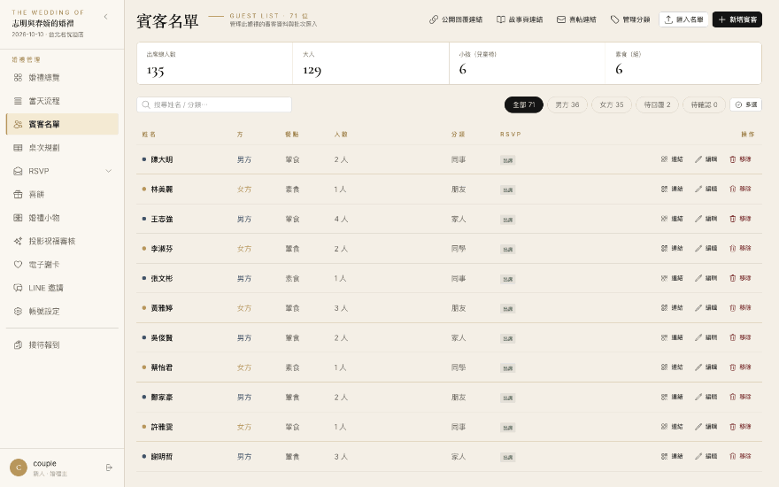

**賓客回覆**：<br>
賓客點連結就能填，不必登入。填完出席資訊，再親手畫一朵花，種進新人的祝福花田。

| 填寫並畫一朵花 | 祝福花田 |
|---|---|
| 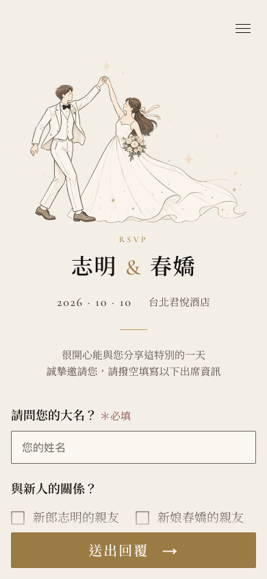 |  |

**桌次排席**：<br>
圓桌圖對應現場佈局，賓客用點選或拖曳入座。按「推薦排序」，系統依禮俗自動帶位：新人與雙親坐主桌、男左女右、長輩靠近主桌。

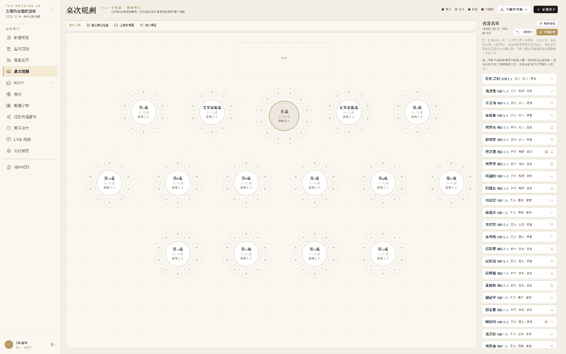

排好之後可以下載兩種檔案：

- **備餐地圖**（給餐廳）：JPEG／PDF
- **賓客名單**：JPEG／PDF／Excel。Excel 有「名單」「桌位圖」兩個工作表

| 下載選單 | 備餐地圖 |
|---|---|
| 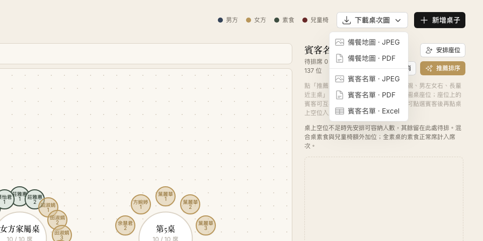 | 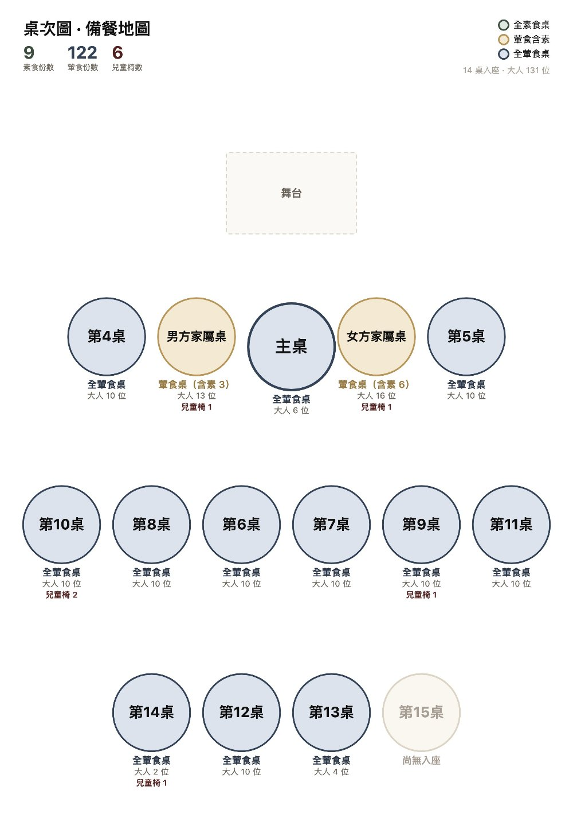 |

**喜餅與婚禮小物**：<br>
喜餅依賓客分類一次帶入款式，自動統計各款盒數與金額。婚禮小物分類管理，採購總額自動加總。

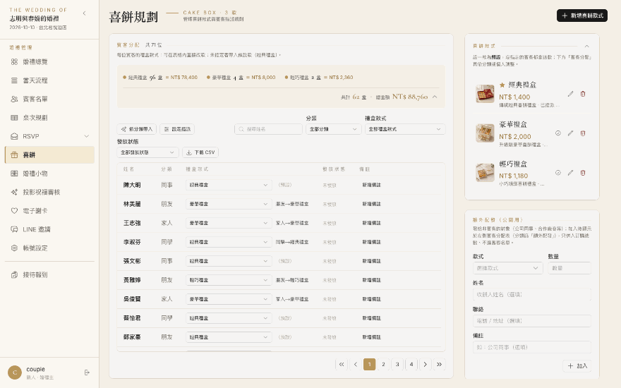

### 當天

**當天流程**：<br>
矩陣表排好每個時段、每個角色的分工。每個角色有一條專屬連結。

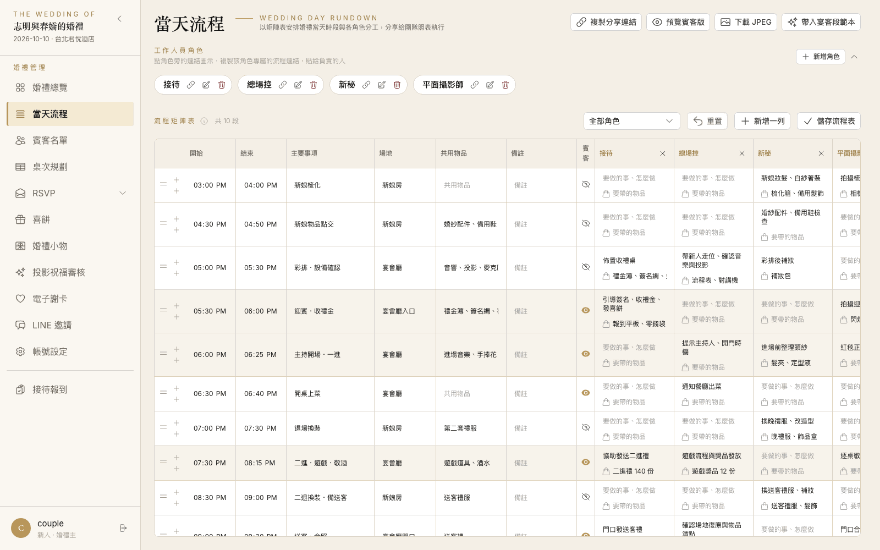

工作人員用手機打開連結，只看到自己的時段、待辦與要帶的物品：

<p align="center">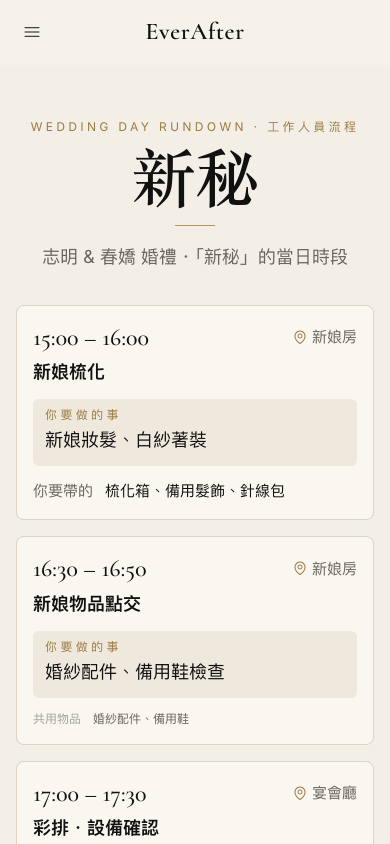</p>

**接待報到**：<br>
搜尋賓客、報到帶位、登記禮金，都在同一個畫面。禮金彙總即時更新。

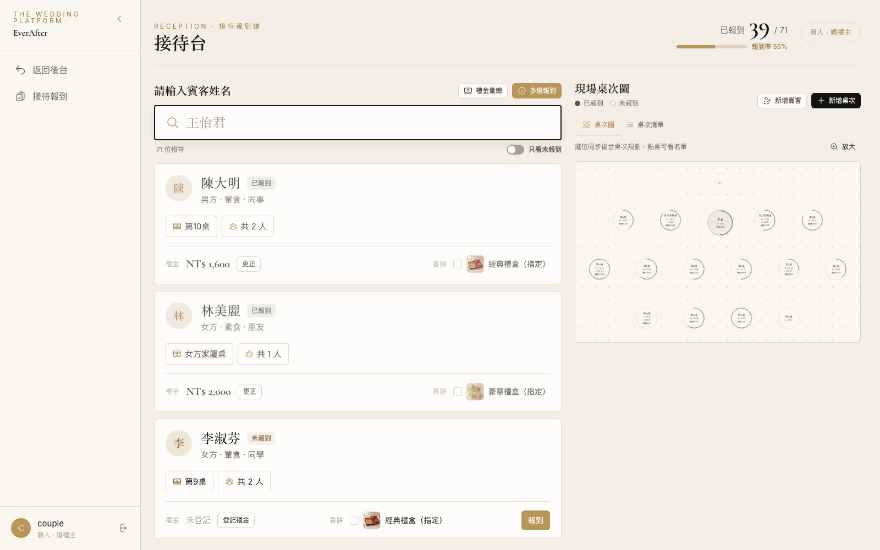

**祝福投影牆**：<br>
後台逐則審核賓客的祝福。通過的祝福即時出現在宴會現場的投影牆跑馬燈。

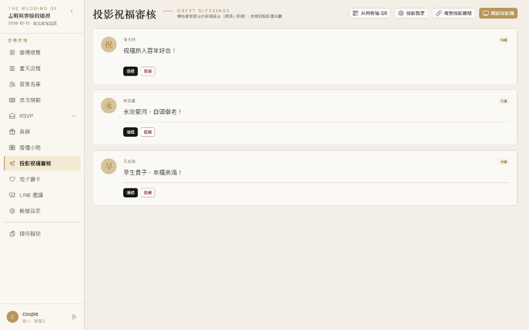

### 婚後

**電子謝卡**：<br>
賓客點開專屬信封，謝卡從信封口升起展開。手機與桌機都支援。

| 手機 | 桌機 |
|---|---|
|  |  |

<details>
<summary><b>更多畫面：7 張高解析靜態截圖</b></summary>

<br>

| 後台總覽 | 賓客名單 |
|---|---|
| 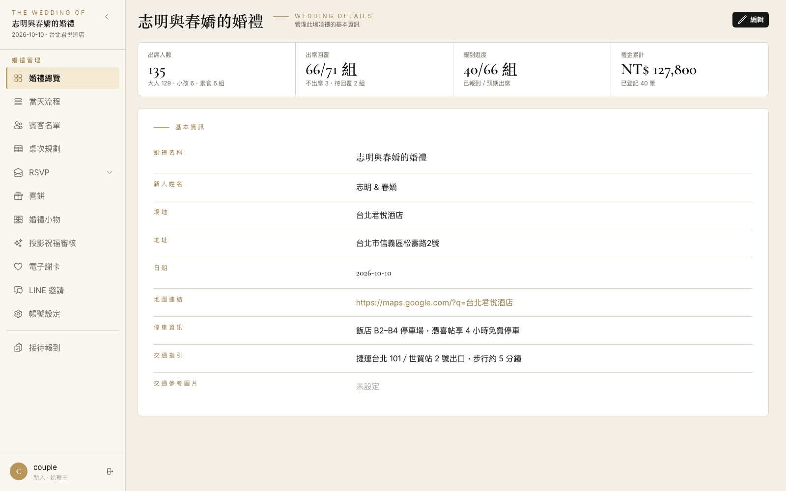 | 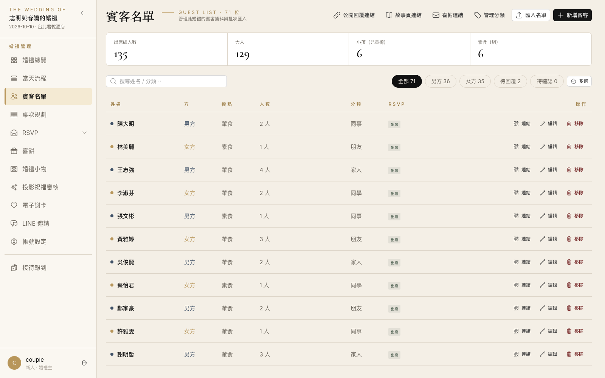 |
| **當天流程** | **喜餅規劃** |
| 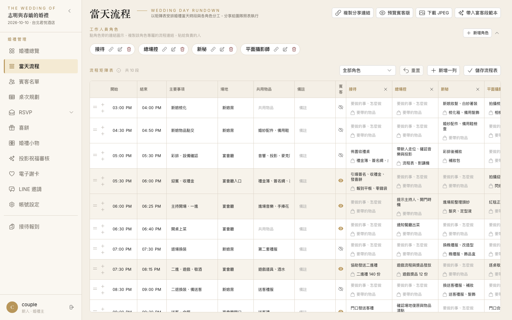 | 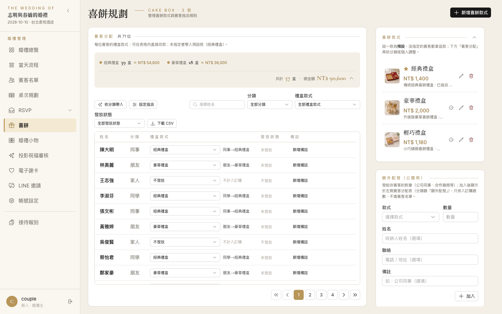 |
| **祝福審核** | **投影牆** |
| 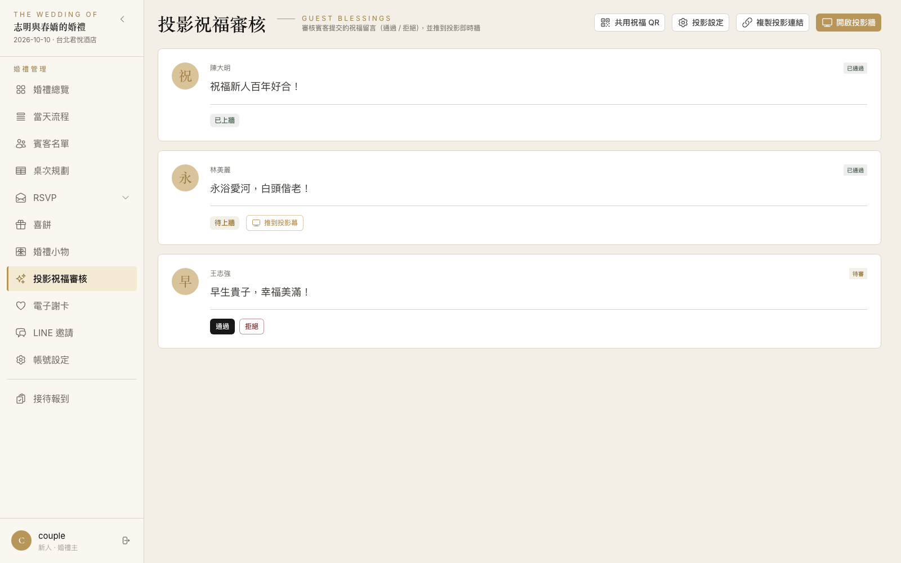 |  |

賓客回覆表單（手機）：

<p align="center">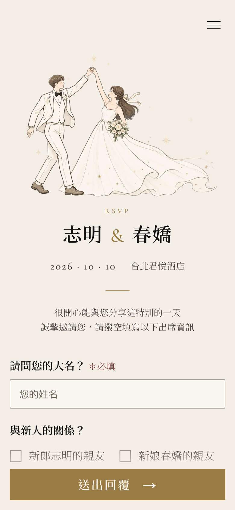</p>

</details>

## 架構

前端（Vue 3）與 API（Nitro）在同一個 Nuxt 4 應用裡，一次部署。每筆資料都帶 `weddingId`，它同時是資料分區與授權邊界。

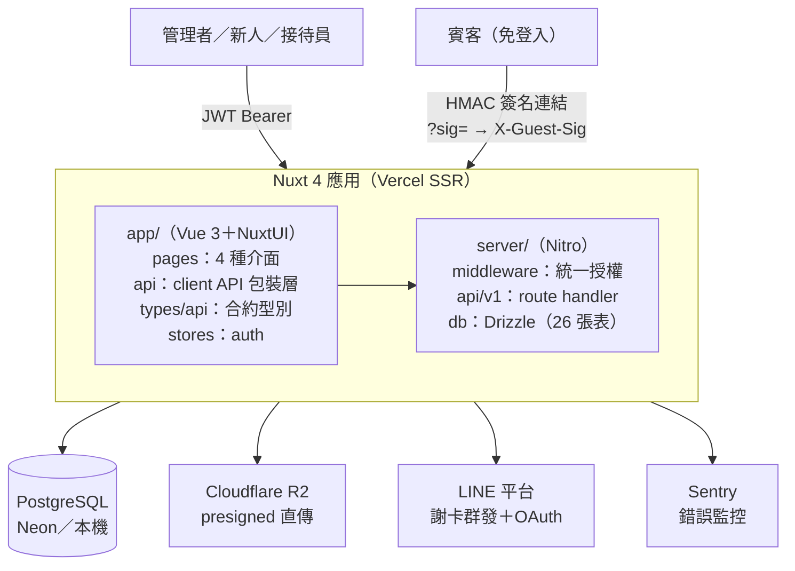

三個刻意的取捨（詳見 [docs/architecture.md](docs/architecture.md)）：

- **務實派 CRUD，不做分層架構**：<br>
  route handler 直接操作 DB，多數 20–50 行。認證與授權全部放在 middleware。一人專案，複雜度花在刀口上
- **型別即合約**：<br>
  `app/types/api/` 是前後端共用的唯一合約來源，元件內禁止定義 local interface
- **賓客簽名不設過期**：<br>
  謝卡等連結在婚後還要長期有效。要全面失效，就輪換 secret

## 工程實踐

**SDD 流程**：<br>
`spec/` 是源頭，程式碼由規格逐層生成：

```
spec/gherkin-feature/*.feature（業務規格）
        ↓ /feature-to-flow
spec/e2e-flows/*.flow.md（Business Invariants = 業務合約）
        ↓ /feature-to-api          ↓ /test e2e spec
app/types/api + server/api    test/e2e/specs/*.spec.ts（凍結）
        ↓ /feature-to-ui
app/pages（為通過 spec 而建）
```

**測試守門**：<br>
E2E 測試分兩種，紅燈的處理方式不同：

| 種類 | 位置 | 紅燈代表 |
|------|------|---------|
| 主 spec（凍結合約，不得修改） | `test/e2e/specs/` | 破壞業務合約，要修程式 |
| vibe spec（保護 UI 迭代） | `test/e2e/vibe/` | UI 改動需要決策 |

測試分四級，離合併越近跑得越多：

| 時機 | 跑什麼 |
|------|--------|
| `git push`（pre-push） | 煙霧測試：`00-auth`、`00-hydration` |
| `/vibe-check` | 煙霧測試＋受影響的 spec |
| 發 PR 前 `/vibe-check --full` | dev 全量 |
| PR 上的 CI | production build＋一次性 Postgres 跑全量（4 shard 平行） |

另外有 commitlint（Conventional Commits）、ESLint，以及自製的視覺層級檢查：用腳本守住「一頁一個主焦點」的設計規範。

**GitHub 流程**：<br>
issue 綁 linked 分支（`feature/#N-描述`）→ PR 自動 `Closes #N` → Squash merge。

## 本機啟動

需要 Docker 與 Node.js 26.13.0（版本以 `.nvmrc` 為準）。

```bash
nvm use       # 切到 .nvmrc 的 Node 版本（Node 22 的 npm 10 會安裝失敗）
npm install
npm run dev   # 自動拉起 Docker Postgres、migrate + seed，零設定
```

**示範帳號**：<br>
`couple`（密碼 `couple1122`），登入後以「新人」視角操作示範婚禮。

**環境變數**：<br>
全部可以留空，沒設定時自動退回本機相容行為。清單見 [docs/architecture.md](docs/architecture.md) §8。

### 載入示範婚禮（選用）

種子資料為了 E2E 測試刻意精簡（19 組賓客、流程表 1 列）。想看演示裡那場「賓客上百人」的婚禮，dev server 啟動後再執行：

```bash
node scripts/demo-data.mjs base        # 賓客與回覆、喜餅、小物、當天流程、謝卡
node scripts/demo-data.mjs reception   # 排完桌之後執行：報到與禮金
```

`base` 不排桌，留給你自己按「推薦排序」。

### 常用指令

| 指令 | 用途 |
|------|------|
| `npm run dev` | 啟動開發伺服器（含本機 DB） |
| `npm run build`／`npm run preview` | SSR 打包／預覽 |
| `npm run db:generate`／`db:migrate`／`db:studio` | 產生 migration／套用 migration／瀏覽資料 |
| `npm run db:create-admin` | 建立正式環境第一位管理員 |
| `npm run eslint`／`npm run typelint` | Lint（含視覺層級檢查）／型別檢查 |
| `npm run test:unit`／`npm run test:e2e` | Vitest／Playwright 主 spec |
| `npx playwright test --config playwright.gate.config.ts` | 守門全量：主 spec＋vibe spec |
| `sh scripts/docker-gate.sh` | 用 production build 跑全量（一次性 Postgres，不碰本機資料） |
| `npm run capture:demo` | 重錄本檔的 GIF 與截圖。先啟動 dev server；會把本機 DB 重置成示範資料 |

## 專案結構

```
app/                  # 前端（Vue 3 + NuxtUI）
├── api/              # per-domain client API 包裝層
├── components/       # 元件（common/ 為跨頁原子元件）
├── pages/            # 頁面路由（後台、公開頁、接待台、投影牆）
├── stores/           # Pinia store（僅 auth）
└── types/api/        # API 合約型別（型別即合約）
server/               # 後端（Nitro）
├── api/v1/           # route handler（務實派 CRUD）
├── db/               # Drizzle schema、migrations、seed
├── middleware/       # 統一認證授權
└── utils/            # JWT、賓客簽名連結、LINE、R2 等
spec/                 # SDD 規格（上游真相）
test/e2e/             # specs/（凍結合約）+ vibe/（UI 保護網）
```

## 技術棧

| 層 | 技術 |
|----|------|
| 前端 | Nuxt 4、Vue 3 Composition API、NuxtUI 4、Tailwind CSS 4、Pinia |
| 後端 | Nitro、PostgreSQL、Drizzle ORM |
| 品質 | TypeScript strict、Playwright、Vitest |
| 部署與外部服務 | Vercel、Neon、Cloudflare R2、LINE Messaging API、Sentry |

## 文件

| 文件 | 內容 |
|------|------|
| [docs/architecture.md](docs/architecture.md) | 系統架構總覽（以程式碼為準） |
| [docs/ops.md](docs/ops.md) | 營運手冊：監控、密碼救援、故障排查 |
| [docs/production-readiness.md](docs/production-readiness.md) | 產品化評估與 roadmap |
| [doc/frontend/frontend-workflow.md](doc/frontend/frontend-workflow.md) | SDD 開發流程 |
